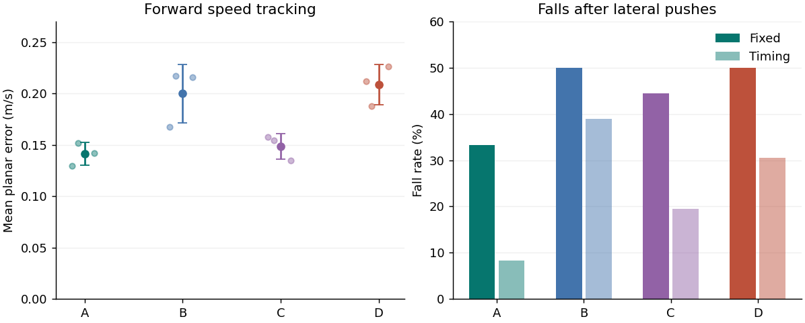
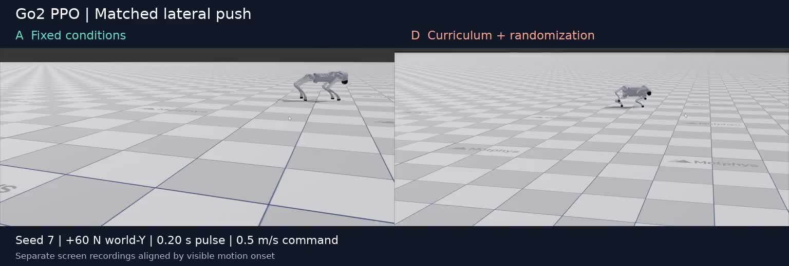
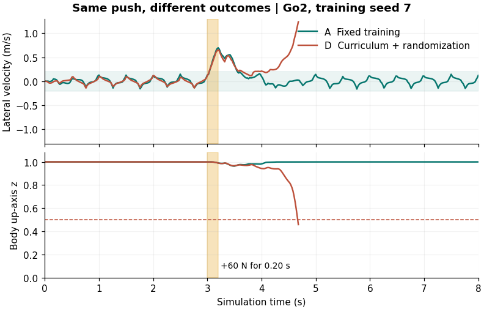

# Go2 Robust RL

**A three-seed ablation of command curriculum and dynamics randomization for quadruped locomotion**

I trained twelve PPO policies for the 12-DoF Unitree Go2 in MotrixLab, using 2,048 parallel environments per run. The study tests whether expanding the velocity-command range over training and randomizing dynamics improve flat-ground tracking and recovery after lateral pushes.

| Group | Command curriculum | Dynamics randomization | Tracking error ↓ (m/s) | Fixed-onset falls ↓ | Timing-sweep recovery ↑ |
| --- | --- | --- | ---: | ---: | ---: |
| A | Off | Off | **0.141 ± 0.011** | **6/18** | **33/36** |
| B | On | Off | 0.200 ± 0.028 | 9/18 | 22/36 |
| C | Off | On | 0.149 ± 0.012 | 8/18 | 29/36 |
| D | On | On | 0.209 ± 0.020 | 9/18 | 25/36 |

Tracking values are mean ± sample SD across three training seeds and five forward commands from 0.2 to 1.2 m/s. A had the lowest mean error and the highest recovery count in both push protocols under the tested conditions. All policies completed the nominal suite, and all policies fell under both signs of the 80 N push.

## 3D push comparison

[Watch the 3D comparison (MP4)](media/go2_3d_comparison.mp4). Captured from MotrixRender on the training Windows machine using the verified seed-7 A and D checkpoints. Both replays use the +60 N world-Y pulse at 3.0 s for 0.20 s while commanding 0.5 m/s forward velocity.

The independently recorded clips are trimmed and aligned by visible motion onset. They retain their recorded playback speed. The D panel holds its final fall frame until A finishes. The camera framing differs between recordings and A includes a late camera adjustment. The source recordings contain no simulator timestamp, so precise recovery latency and fall timing are reported from telemetry below.

## Telemetry comparison

[Watch the telemetry animation (MP4)](media/push_comparison.mp4). Both policies were trained with seed 7 and tested with the same +60 N pulse at 3.0 s. A regained lateral stability, while D fell at 4.68 s. This selected example shows recorded simulator signals.

## Reproduce

- [Technical report](REPORT.md) describes the training design, force calibration, results and limitations.
- [Reproduction guide](REPRODUCE.md) gives commands for training, evaluation and figure generation.
- [Episode data](data/episodes.csv) covers all 360 evaluation rollouts. [Training audit](data/training_runs.json) records the configuration, versions and checkpoint hashes. The two example CSVs provide the full control-rate telemetry for the animated comparison.

The study builds on the Go2 model and locomotion task in [MotrixLab](https://github.com/Motphys/MotrixLab) and uses skrl PPO with PyTorch.
